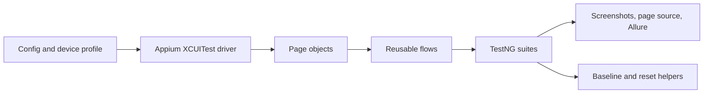

# iOS Simulator and Device Automation Framework

Appium/XCUITest automation for a private iOS nutrition application. The framework uses the same page objects and flows for an iOS Simulator and a real iPhone, selected through configuration.

Publication approval was obtained for this sanitized portfolio version. Private application binaries, credentials, URLs, screenshots, and company-identifying material are intentionally excluded.

## What this demonstrates

- Phase-oriented onboarding flows backed by page objects and reusable gesture helpers.
- Configuration-driven simulator/real-device switching from one driver factory.
- Baseline and app-state reset helpers for repeatable regression runs.
- Failure classification, locator suggestions, screenshots, page-source capture, and Allure attachments.
- Unit-testable framework code separated from tests that require a private app and Apple toolchain.

## Tech stack

Java 17, Maven, Appium Java Client 10.1.1, Selenium 4.49.0, TestNG 7.12.0, Allure TestNG 2.35.5, and AspectJ 1.9.25.1. The versions are taken from `pom.xml`.

## Architecture

```text
src/test/java/com/portfolio/ios/
├── core/       typed config, driver creation, waits, gestures, diagnostics
├── pages/      page objects and platform locators
├── flow/       reusable onboarding flow
├── fixtures/   reset and baseline helpers
├── model/      profile and option objects
└── tests/      onboarding, smoke, regression, health, and classifier tests
ci/             local/CI helper scripts
```



## Design decisions

Configuration is resolved from JVM properties, environment variables, and a local ignored file so device and signing values stay out of source control. Waits poll named conditions instead of relying on fixed sleeps. Page objects keep selectors and gestures out of test classes. Failure artifacts are captured centrally. Baseline restore is used where tests require an untouched app state.

## Coverage and status

A code scan found 101 test source files and 173 `@Test` methods. The suite contains onboarding phases, smoke checks, regression modules, locator health checks, device-availability checks, and unit tests for failure classification and healing suggestions. The count is a source-code count, not a claim that all tests passed in this environment.

The application under test is private and is not included. End-to-end tests require a compatible app build, Appium, Xcode, and either a simulator or a provisioned iPhone. The Android path is not part of this repository.

## Setup and run

1. Install Java 17, Maven, Node.js, Appium, the XCUITest driver, and Xcode on macOS.
2. Copy `src/test/resources/config.example.properties` to `src/test/resources/config.properties`.
3. Fill in local app path, simulator/device profile, signing, and Appium values. Keep the copied file untracked.
4. Run `mvn -q -DskipTests compile` to verify compilation.
5. Run unit-oriented checks with the relevant TestNG groups or suites. Full suites require the private app and Apple environment.

Allure results are written under Maven `target/` and are ignored. No report or test result is claimed by this repository.

## Limitations and next steps

This sanitized copy cannot execute the private app flow by itself, and real-device execution requires macOS, Xcode, signing, and Appium. Next improvements would be a small public fixture app, CI coverage for the pure Java helpers, and a documented device matrix.

## AI assistance

The framework was developed with AI assistance. The design, review, sanitization, and execution claims in this README should be understood as the author's responsibility; no claim is made that every line was typed manually.
